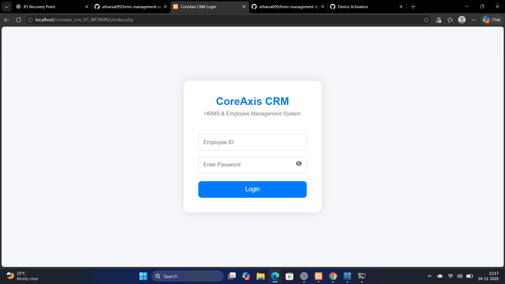
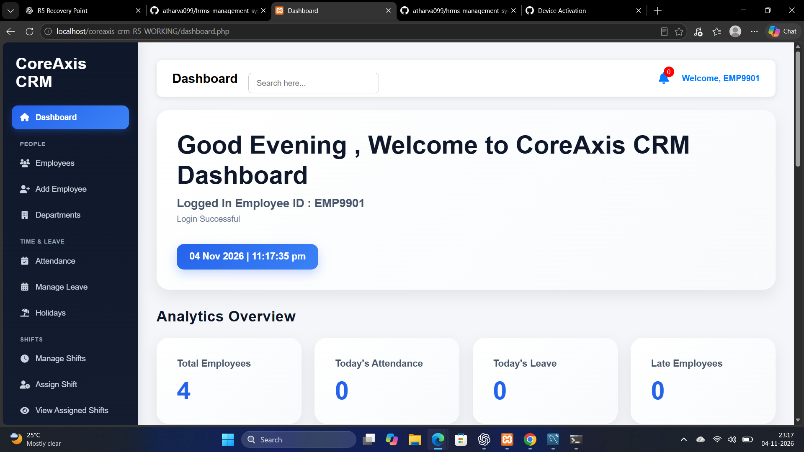
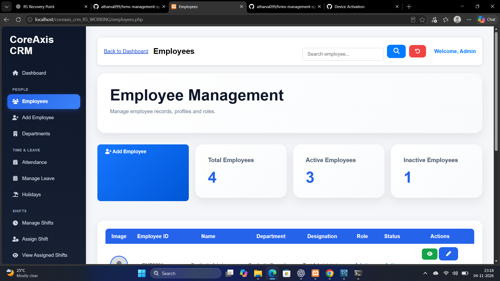
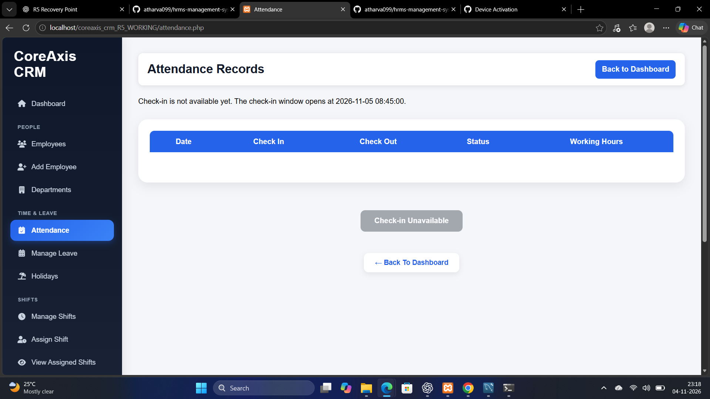
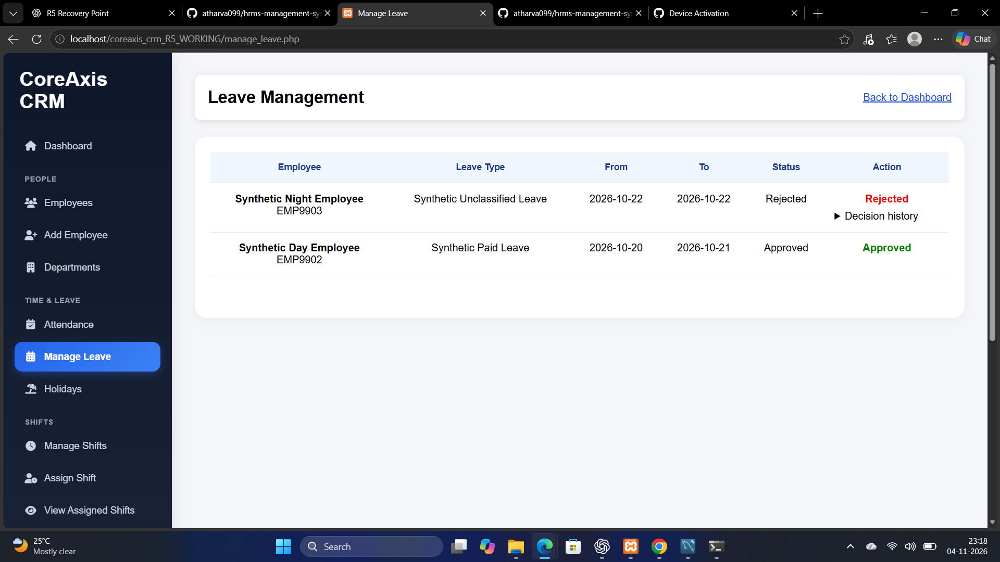
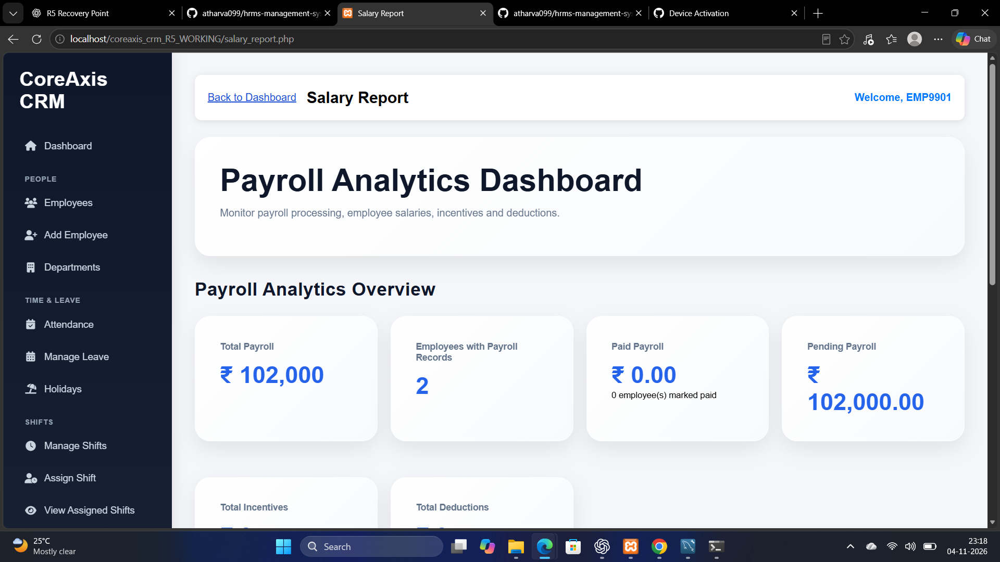

# CoreAxis CRM

CoreAxis CRM is a server-rendered PHP HRMS for a college demonstration. Existing modules cover authentication, employees and departments, attendance, shifts, holidays, leave and decisions, notifications, dashboard summaries, attendance reports, and historical salary views/slips.

Salary generation and payment are intentionally disabled. Stage-only policy and preview pages require a separate payroll-stage configuration/schema and are not part of the standard college schema.

## Project Screenshots

### Login

### Dashboard

### Employee Management

### Attendance

### Leave Management

### Salary Report

## Current verification — 2026-11-04

- Portable database-free tests: **28/28 PASS**, including the Admin bootstrap contract test.
- PHP lint: **93/93 PASS** in the current integration worktree; the existing staged publication snapshot predates the bootstrap additions.
- `git diff --check`: **PASS**.
- Six integration/review contracts: **NOT RUN** and not included in the staged publication tree because they depend on excluded setup or migration sources.
- The operator reports five manual protected-runtime EMP9902 checks passed, including rejection of the valid password while inactive and rejection of an existing session after deactivation. This is user-observed evidence, not an automated result or independent retest.
- Admin read-only browser evidence covers core pages. Employee browser evidence confirms the Dashboard and Employee navigation; a complete Employee page walkthrough remains unverified.
- Fresh database installation: **NOT VERIFIED**. The schema-only installer was statically assembled from two matching synthetic MySQL 8 schema sources and was not imported into a fresh database during this task.

## Requirements and database setup

Use PHP 8 with MySQLi, Apache, and MySQL 8.0.16 or newer (the source schema was prepared for MySQL 8.0.46). Other MySQL/MariaDB versions need compatibility verification.

1. Back up and create a **new, empty** MySQL schema using an authorized database operator. The included `database/schema_mysql8.sql` creates tables and audit triggers only. It does not create/select a database or user, grant privileges, seed data, or contain reset logic. Select the intended empty schema in MySQL Workbench or the MySQL CLI before importing it. If import stops partway, inspect the schema before doing anything else; do not blindly rerun.
2. Create a dedicated least-privilege runtime account separately. This repository does not provide a grant script. Do not use `root` as the application account.
3. Supply `COREAXIS_DB_HOST`, `COREAXIS_DB_PORT`, `COREAXIS_DB_NAME`, `COREAXIS_DB_USER`, and `COREAXIS_DB_PASSWORD`, or set `COREAXIS_DB_CONFIG_FILE` to an operator-managed PHP configuration outside the document root. Restrict access to that file. Never commit credentials.
4. The schema contains no Admin or Employee rows. There is no default account or password. Leave `COREAXIS_DB_MODE` unset or empty. For XAMPP, set `COREAXIS_PHP_CLI` in the local PowerShell session to the installed `php.exe` path if it is not already on `PATH`.
5. From the project root in PowerShell, run `.\tools\bootstrap_admin.ps1`. It asks you to confirm the exact configured database name and MySQL port, collects the required Admin profile fields, then requests the password twice using hidden input. The PHP entrypoint is CLI-only, validates MySQL 8.0.16+, the selected schema, the external configuration location, and a non-root account; it takes a database-scoped advisory lock and inserts one Active Admin only when `users` is empty. It never supplies default credentials or updates an existing account. The bootstrap implementation has passed static tests but has **not** been exercised against a fresh database; fresh-install verification remains **NOT VERIFIED**.
6. Start Apache and MySQL, configure the local virtual path, and sign in with the locally provisioned synthetic Admin. Create demo Employees through the Admin UI. Do not import live employee data.

If setup fails before the insert commits and no user exists, correct the external configuration/schema issue and rerun after reviewing the sanitized failure code. If any user exists, the bootstrap refuses to run. Use the normal authorized Admin account-management workflow when an Admin can sign in; if no Admin can sign in, use a separately reviewed operator recovery process that preserves existing rows. Do not delete users or audit data to rerun bootstrap.

The installer does not include the optional payroll-stage schema or its migration candidates. `payroll_policy.php` and `payroll_preview.php` require a separately configured stage database and are unavailable without it. Do not apply stage-only migrations to the college schema or a protected database.

## Demo and test instructions

See [TESTING.md](TESTING.md) for the read-only Admin/Employee demonstration sequence and exact test classifications. Use an existing verified runtime and database for the demonstration; the new schema installation itself is not yet runtime-verified. Keep credentials outside the repository and enter them directly in the browser.
